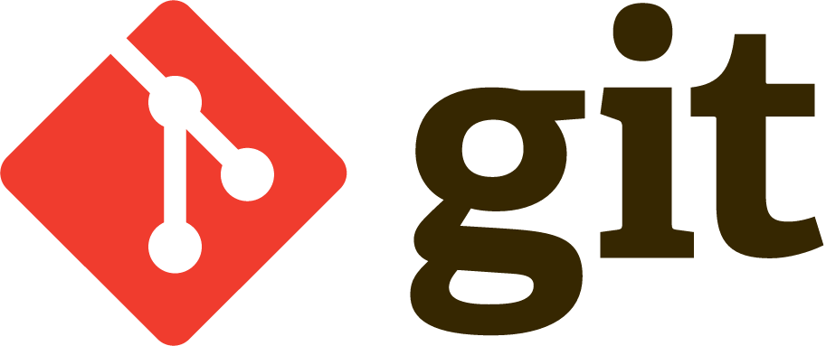

# prueba_Adam

**prueba_Adam** es un repositorio de prácticas de 2DAW para aprender *Git* y *GitHub*.

## Qué contiene

- Prácticas de Git y ramas
- Pull Requests y versionado con tags
- Documentación con MkDocs

## Empezar

Consulta la [guía de instalación](instalacion.md).

